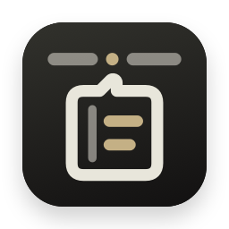
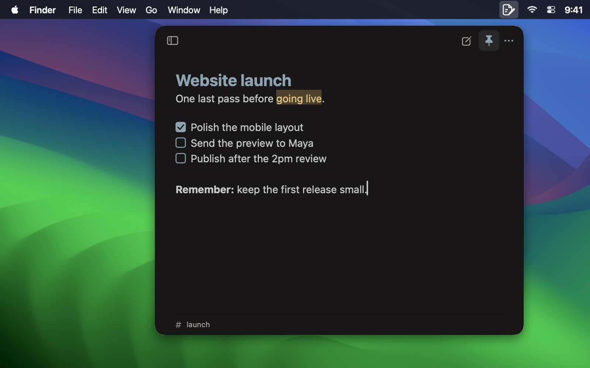
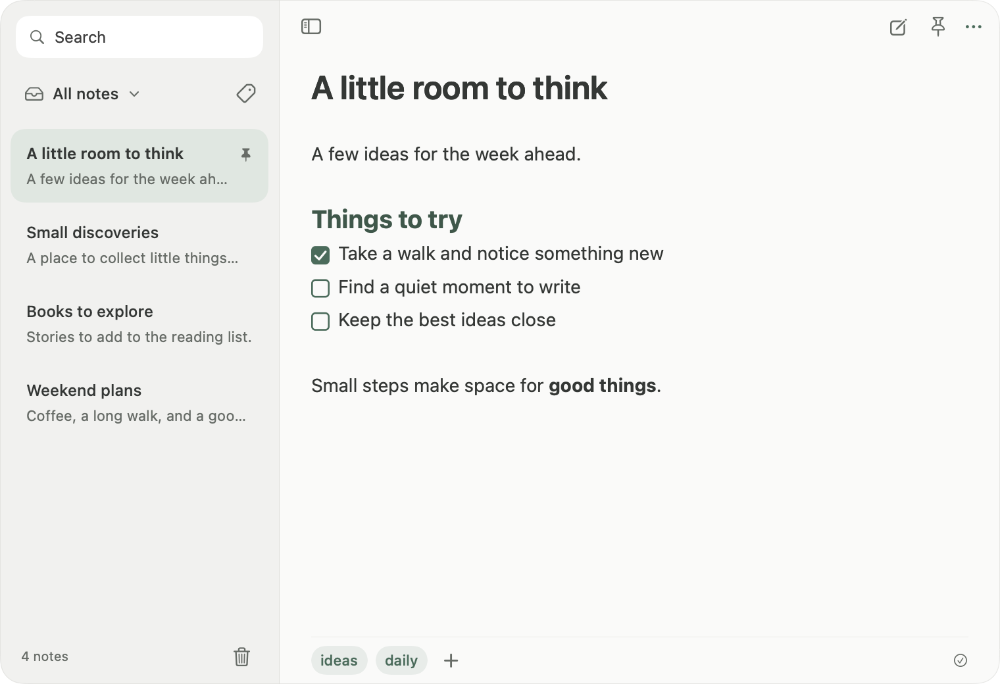
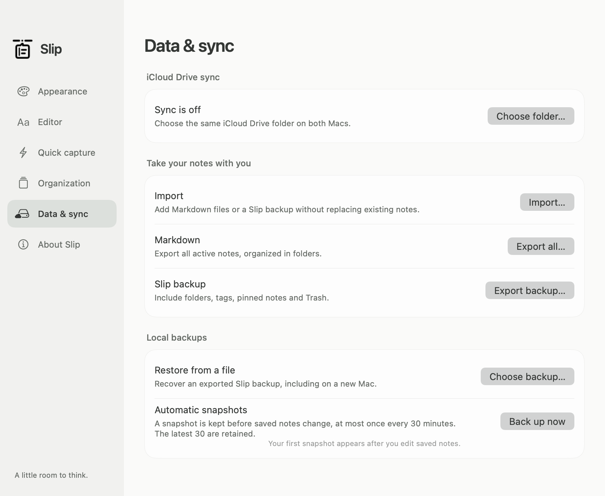

<div align="center">



# Slip — Quick notes from your Mac menu bar

**Click the menu bar icon. Write a note. Get back to work.**

A free, open-source **macOS menu bar notepad**. Press **⌃⌥N** from any app to capture a thought, a quick checklist or a bit of Markdown. Press **Escape** to tuck it away. Your notes save automatically.

**Native macOS · Works offline · Optional iCloud Drive sync · No Slip account**

[Download](https://github.com/berkinduz/slip-menu-note-app/releases/latest) · [Features](#made-for-quick-capture) · [User guide](docs/USAGE.md) · [Report an issue](https://github.com/berkinduz/slip-menu-note-app/issues)

</div>



## Install

Requires **macOS 14+ and Apple Silicon**.

Install with the [Homebrew tap](https://github.com/berkinduz/homebrew-tap):

```sh
brew install --cask berkinduz/tap/slip
```

Or download the [latest DMG](https://github.com/berkinduz/slip-menu-note-app/releases/latest), open it and drag **Slip → Applications**. Click its menu bar icon or press **⌃⌥N** to write.

Builds are ad hoc signed and not notarized. If macOS blocks the first launch, follow [Apple’s opening-app guidance](https://support.apple.com/en-us/102445).

## Made for quick capture

- **Always in your menu bar.** One click or **⌃⌥N** opens your notes over the app you’re using. Write immediately without a title; pin the panel to keep it open across apps.
- **Write in Markdown.** Live formatting, clickable checklists, links, code blocks and `/` commands. Complete a task with **⌘Return**; paste a URL over selected text to make a link.
- **Find things again.** Folders, manual tags, search, pinned notes, Trash and deletion Undo.
- **Continue on another Mac.** Choose the same iCloud Drive folder on both Macs. Edit offline; conflicting edits are retained as separate notes. Preferences stay local.
- **Keep your data.** Markdown import/export, complete Slip backups, automatic local snapshots and confirmed restore.
- **Stay ready.** Launch at login, update checks, themes and typography settings. Panel size, caret and scroll position are remembered.

<details>
<summary>See the notebook and sync settings</summary>





</details>

## Sync and storage

Notes are saved locally in `~/Library/Application Support/Slip/`. Sync is optional: select a folder in **Settings → Data & sync** on each Mac. iCloud Drive handles transfer; a local folder write does not confirm receipt on the other device. Backups remain separate from sync.

Version 0.3.0 has local replica and editor tests; transfer between two physical Macs and login-after-reboot still need verification. See the [user guide](docs/USAGE.md) for setup, shortcuts and recovery.

## Build from source

Use **Xcode 16+ and Swift 6**:

```sh
git clone https://github.com/berkinduz/slip-menu-note-app.git
cd slip-menu-note-app
swift test
./scripts/build-app.sh
```

Built with **SwiftUI and AppKit**. The script creates `Slip.app` beside the repository. [Contribute](CONTRIBUTING.md) · [Changelog](CHANGELOG.md) · [Homebrew distribution](distribution/homebrew/README.md).

Made by [berkinduz](https://github.com/berkinduz). [Buy me a coffee](https://buymeacoffee.com/berkinduz).

[MIT license](LICENSE) · [Third-party credits](Resources/THIRD-PARTY-NOTICES.txt)
