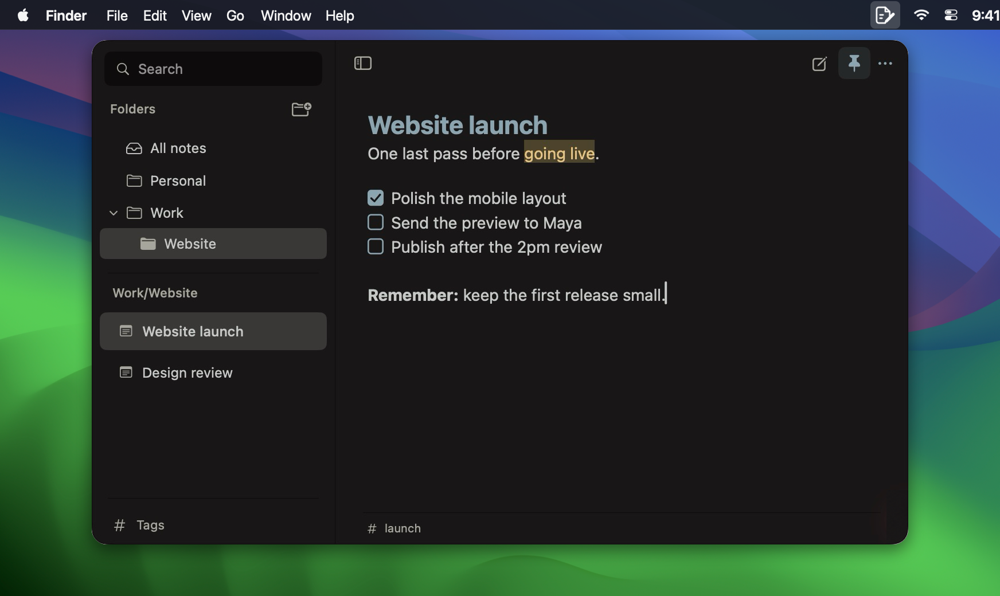

<div align="center">

 

# Slip — notes in your Mac menu bar

**Capture a thought. Check off the next thing. Get back to work.**

Slip is a free, open-source **macOS menu bar app for quick notes, Markdown, and lightweight to-do lists**. Open it with a global keyboard shortcut, write without a title, and tuck it away when you're done. Your notes stay on your Mac.

[**Download for macOS**](https://github.com/berkinduz/slip-menu-note-app/releases/latest) · [How to use](#how-to-use) · [Keyboard shortcuts](#keyboard-shortcuts) · [Contribute](CONTRIBUTING.md)


</div>

## Quick install

Requires **macOS 14 or later on Apple Silicon**. No account or subscription.

1. Download **[Slip-v0.2.2-macos-arm64.dmg](https://github.com/berkinduz/slip-menu-note-app/releases/download/v0.2.2/Slip-v0.2.2-macos-arm64.dmg)** from the [latest release](https://github.com/berkinduz/slip-menu-note-app/releases/latest).
2. Open the DMG and drag **Slip** to **Applications** in the window that appears.
3. Open Slip from Applications, then eject the disk image. Look for Slip’s notebook icon in your menu bar.

Prefer an archive? A ZIP is also available in the release assets.

The release is ad hoc signed and **not notarized**. macOS may show a warning on first launch; see Apple's [opening-app guidance](https://support.apple.com/en-us/102445). Each release includes a SHA-256 checksum.

## How to use

- **Open and capture:** click the menu bar icon or press **Control–Option–N**. Start writing immediately; a title is optional. Untitled notes use their first content line in the list.
- **Keep track of work:** type `/task` to start a checklist. Click the clear task boxes to check an item off. Return continues the list; Return on an empty item ends it.
- **Stay with a task:** click the **pin in the header** to keep the panel open when switching apps. Click it again to return to quick capture behavior.
- **Make another note:** use the **new-note icon at the top right** or **Command–N**.
- **Return to work:** press **Escape** to dismiss a menu or hide the panel. Notes save automatically, and the sidebar remembers whether you left it open.

Slip works well for meeting follow-ups, a short daily to-do list, a launch checklist, and ideas you want to catch while working in another app.

## Markdown that stays readable

Write and read in the same editor. Completed formatting markers disappear while the formatting remains visible. Unfinished syntax stays visible as you type; the stored note remains Markdown.

- Headings, **bold**, *italic*, strikethrough, and `==highlight==`.
- Clickable task lists, bullet lists, numbered lists, and quotes.
- Inline code, fenced code blocks, links, and dividers.
- A theme-matched **`/` command menu**, plus familiar formatting shortcuts.

Select text and press **Command–K** to add a link. Ordinary copy takes the visible text. Choose **More → Export → Copy Markdown** for the source, or **Markdown file…** to export a note.

## Folders for structure, tags for connections



Give each note a home in a **folder or nested folder**. Use the folder-plus button to create a folder, or right-click a folder to add a subfolder, rename it, or move it. Create a note while a folder is selected to put it there automatically. Use **Move to folder** in a note’s menu to reorganize it.

**Tags work independently of folders.** Add them manually from the slim footer under a note; suggestions help reuse existing tags. Use the small **Tags** entry at the bottom of the sidebar to filter across folders. A tag never creates a folder, and typing `#words` in the note does not add tags.

Search with **Command–F** to find titles and content, or use `#launch` for tag search. Partial tag matches work too. Combine terms such as `#work #meeting notes#` to match both tags. Tag names stay lowercase; your note text, titles, and folder names keep the case you enter.

Removing a folder keeps its notes in the parent folder. Notes moved to **Trash** can be restored. Pin important notes to the top of the list through their menu; the header pin separately controls whether the panel stays open.

## Keyboard shortcuts

| Action | Shortcut |
| --- | --- |
| Open or hide Slip | Control–Option–N |
| New note | Command–N |
| New folder | Shift–Command–N |
| Search notes | Command–F |
| Bold / italic / inline code | Command–B / Command–I / Command–E |
| Add or edit a link / highlight | Command–K / Shift–Command–M |
| Heading / bullet list / task list | Shift–Command–H / L / T |
| Show or hide the sidebar | Shift–Command–S |
| Settings | Command–Comma |
| Dismiss a menu or hide the panel | Escape |

## Make it feel at home

Slip is a native **SwiftUI and AppKit** macOS app. The default appearance pairs **Kanagawa Dragon** with **SF Pro Text**. Settings include System, Light, and Dark themes, your installed fonts, font size, line height, ligatures, spell checking, and list continuation.

## Local by default

Slip works offline. It needs no account or cloud service. Notes, folders, and tags are stored locally in `~/Library/Application Support/Slip/`; use **Show folder** in Settings to find your data. Export notes as Markdown when you want to take them elsewhere.

**Cloud sync is not included.** The downloadable build targets Apple Silicon; an Intel release is not currently provided.

## Contributing

Bug reports, thoughtful UI improvements, and code contributions are welcome. The goal is a fast, quiet menu bar notepad that makes small actions easy to capture and organize.

Read **[CONTRIBUTING.md](CONTRIBUTING.md)** for setup and development notes, [report a bug](https://github.com/berkinduz/slip-menu-note-app/issues), or open a pull request. If Slip fits your day, sharing it helps other people find it.

### Build from source

Install Xcode 16 or later with Swift 6, then run:

```sh
./scripts/build-app.sh
swift test
```

The script creates `Slip.app` next to the project directory and signs it ad hoc. It does not notarize or launch the app.

## License

Slip is available under the **[MIT License](LICENSE)**. Kanagawa Dragon attribution is included in [third-party notices](Resources/THIRD-PARTY-NOTICES.txt). macOS interface elements and the Sonoma wallpaper shown in the promotional images belong to Apple.
