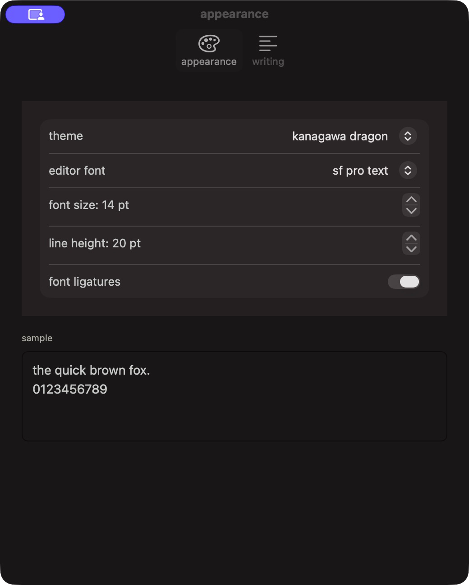

# slip


Quick notes and small to-dos, one shortcut away. Catch a thought or jot down your next action without leaving what you're doing.


## Install

slip 0.1.0 requires **macOS 14 or later on Apple Silicon**.

1. Download `Slip-v0.1.0-macos-arm64.zip` from the [latest release](https://github.com/berkinduz/slip-menu-note-app/releases/latest).
2. Unzip it and move `Slip.app` to Applications.
3. Open slip. Its icon appears in the menu bar; it does not add an icon to the Dock.

The release is ad hoc signed and is **not notarized**, so macOS may show a security warning on first launch. See Apple's guidance on [opening an app from an unidentified developer](https://support.apple.com/en-us/102445).

## How to use

Click the menu bar icon or press **Control–Option–N** to open slip. Start typing: a title is optional, and an untitled note uses its first content line in the list. Press **Escape** to dismiss a menu or hide the panel. Notes save locally as you work.

Write and read in the same editor. Completed Markdown formatting markers disappear while the formatting stays visible; unfinished syntax remains visible as you type. The stored note remains Markdown. slip supports headings, bold, italic, strikethrough, highlight (`==text==`), inline code and code blocks, links, lists and tasks, quotes, and dividers.

Use `/task` to start a to-do list. Click a checkbox to complete or reopen an action; Return continues the list, and Return again on an empty item ends it.

Select text and press **Command–K** to add a link using its visible text and URL. Ordinary copy takes the visible text. To copy the source, choose **more → export → copy markdown**; use **markdown file** to export a note as a file.

Type `/` for quick commands, including highlight. Use the arrow keys and Return or Tab to choose, or Escape to dismiss the menu.

## Organize with tags


Use the slim tag footer to add or remove a note’s tags, or choose **more → tags**. Enter a name such as `work/ideas` or `meeting notes`, and choose an existing suggestion if you like. Tags are stored as metadata; typing a hashtag in the note does not add one.

Open the sidebar with **Shift–Command–S**. Tag groups appear under search, with a separate note list below. Expand a parent tag to see its children. Select a tag to filter notes, including notes in its nested children. Search supports partial matches: `#ide` can find `work/ideas`. Combine tag terms such as `#work #meeting notes#` to find notes matching both. Right-click a tag to choose an optional monochrome icon or reset it. Tags are the organizing system; there are no separate folders.

The **more** menu also offers an optional title, pinning, export, note filters, and Trash. Restore notes from Trash when needed.

## Shortcuts

| Action | Shortcut |
| --- | --- |
| Open or hide slip | Control–Option–N |
| New note / search | Command–N / Command–F |
| Bold / italic / inline code | Command–B / Command–I / Command–E |
| Add or edit link / highlight | Command–K / Shift–Command–M |
| Heading / bullet list / task | Shift–Command–H / L / T |
| Show or hide sidebar | Shift–Command–S |
| Settings | Command–Comma |
| Dismiss or hide | Escape |

## Settings and storage

<details>
<summary>See appearance settings</summary>



</details>

Open **settings** with Command–Comma. The appearance pane lets you choose the theme, editor font, font size, line height, and ligatures. The default is the VS Code Kanagawa Dragon palette with the system font (SF Pro Text) at 14 pt and a 20 pt line height. System, Light, and Dark themes are also available. Existing font choices remain unchanged.

The writing pane covers spell checking, list continuation, slash commands, keeping the panel open, and showing the sidebar at launch. Use **show folder** there to find your local notes and preferences. slip needs no account or cloud service.

## Build from source

Install Xcode 16 or later with Swift 6, then run:

```sh
./scripts/build-app.sh
swift test
```

The build script creates `Slip.app` next to the project directory and signs it ad hoc. It does not notarize or launch the app. See [CONTRIBUTING.md](CONTRIBUTING.md) for development notes.

## License

slip is available under the [MIT License](LICENSE). The Kanagawa Dragon palette's attribution and license are included in [third-party notices](Resources/THIRD-PARTY-NOTICES.txt).
