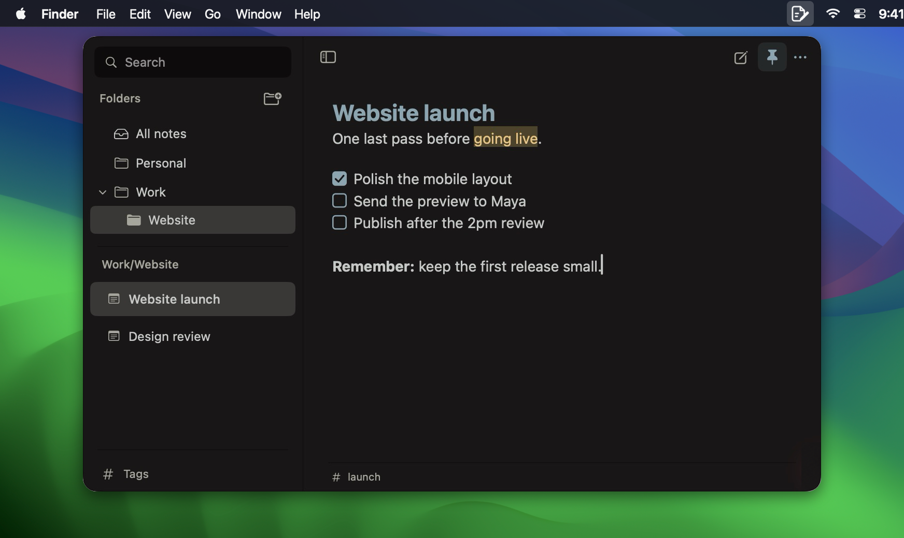
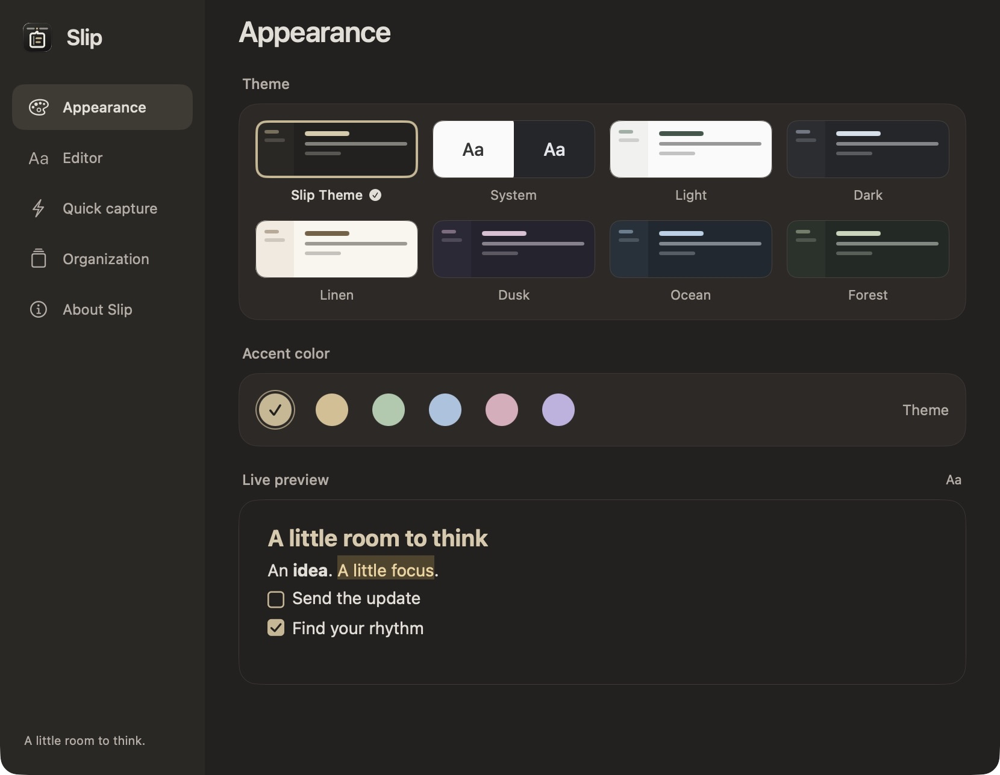

# Using Slip

[Back to Slip](../README.md)

## How to use

1. **Catch a thought.** Click Slip's menu bar icon or press **⌃⌥N**. Start writing immediately. Titles are optional; the note list can use the first line instead.
2. **Turn it into an action.** Type **`/`** for quick commands, then choose a task list, heading, or another format with the arrow keys and Return. Click a task box to check it off.
3. **Keep it close.** Use the header pin to keep the panel visible while switching apps. Use **⌘N** or the compose button at the top right for another note.
4. **Get back to work.** Press **Escape** to dismiss a menu or hide Slip. Changes save automatically. Reopening the panel restores your sidebar preference.

Use it for a few work follow-ups, a meeting note, a daily checklist, or an idea that shouldn't interrupt your flow.

## A little Markdown

Write and read in the same place. Completed Markdown markers disappear into the formatting, so `**bold**` becomes **bold** without switching to a preview. Your note is still stored as Markdown.

Slip supports headings, bold, italic, strikethrough, highlights, links, inline code, fenced code blocks, quotes, dividers, bullet and numbered lists, and clickable task lists. The **`/` menu follows your theme**, and formatting shortcuts keep your hands on the keyboard.

**Checklists are first-class notes.** Return continues the list; Return on an empty item ends it. If quick actions are your usual workflow, set **Settings → Quick capture → New notes start with → Checklist** so every new note is ready for a task.

Press **⌘Return** to complete or reopen the task on the current line. Use **Tab / ⇧Tab** to indent or outdent list items. Pasting a web URL over selected text turns that text into a link. These edits support Undo.

Select text and press **⌘K** to add a link, or **⇧⌘M** to highlight it. Regular copy gives you the visible text. Use **More → Export → Copy Markdown** for the source, or **Markdown file…** to export a note.

## Organized when you need it

### Folders without a crowded sidebar

The sidebar puts your **notes** first. Click the location above the note list to choose **All notes**, **Pinned**, or a folder. Search for a folder or use its arrow to browse subfolders, one level at a time.

Use the folder-plus button in this chooser to create a folder. Right-click a folder to create a subfolder, rename it, move it, or remove it. New notes go into the selected folder; **Move to folder** in a note's menu handles the rest. Removing a folder keeps its notes in the parent folder.

### Tags you add yourself

Add tags from the small **footer beneath your note**. Type a name, reuse a suggestion, or create one explicitly. Use **↑ / ↓** to choose, **Return** to add, and **Escape** to return to writing. Typing `#words` in a note does not create tags.

The **tag button beside the sidebar's location selector** opens a searchable tag browser with note counts. Filter across folders, give a tag a monochrome icon, or rename it. Renaming to an existing tag offers an explicit **Merge**. Removing a tag keeps the notes and their contents.

Folders give a note one home; tags connect notes across those homes. Tag names stay lowercase. Your titles, folder names, and note text keep the case you enter.

### Find it again

Press **⌘F** to search titles and content. Start a query with `#work` to search by tag, or combine it with text, such as `#work feedback`. Choosing a matching note reveals its first matching body text. Pin frequently used notes through their menu to keep them at the top of the list. Deleted notes go to **Trash**, where they can be restored; the deletion message also offers **Undo**.

## Make it feel like yours

Settings has dedicated pages for **Appearance**, **Editor**, **Quick capture**, **Organization**, **Data & sync**, and **About Slip**. Open it with **⌘,** or **More → Settings…**.

- **Appearance:** choose **Slip Theme**, System, Light, Dark, Linen, Dusk, Ocean, or Forest. Keep the theme's accent or pick Sand, Sage, Blue, Rose, or Violet.
- **Editor:** use SF Pro Text, SF Mono, or an installed font. Adjust size, line height, paragraph spacing, page margins, and ligatures with a live Markdown sample. Set spell checking, autocorrect, and smart punctuation to suit your writing.
- **Quick capture:** start with a blank note, checklist, or bullet list. Enable **Launch at login** to keep Slip in the menu bar after signing in to your Mac. Login launches keep the panel closed; manual launches respect **Show panel on launch**. Choose whether Slip stays open across apps, continues lists, or shows slash commands.
- **Organization:** sort by last edit, creation date, or title; show or hide note previews and word count; open your local data folder.
- **Data & sync:** choose an iCloud Drive sync folder, import/export notes, and create or restore backups.
- **About Slip:** check for updates, open release notes or a download, and find source code and contribution links. Automatic checks use public GitHub release metadata at most once a day. Installing an update remains your choice.

Slip remembers the panel size and each note’s caret and scroll position on this Mac.

## Keyboard shortcuts

On Mac, **⌘** is Command, **⌥** is Option, **⌃** is Control, and **⇧** is Shift.

| Action | Shortcut |
| --- | --- |
| Open or hide Slip from another app | ⌃⌥N |
| New note / new folder | ⌘N / ⇧⌘N |
| Search notes | ⌘F |
| Bold / italic / inline code | ⌘B / ⌘I / ⌘E |
| Add or edit a link | ⌘K |
| Highlight | ⇧⌘M |
| Heading / bullet list / task list | ⇧⌘H / ⇧⌘L / ⇧⌘T |
| Complete or reopen the current task | ⌘Return |
| Indent / outdent list items | Tab / ⇧Tab |
| Show or hide the sidebar | ⇧⌘S |
| Settings | ⌘, |
| Dismiss a menu or hide the panel | Escape |

## Local notes and optional sync

Slip works offline without a Slip account. Its local library, preferences, editor positions and backups live in **`~/Library/Application Support/Slip/`**. Open the folder from Settings. A small footer indicator distinguishes local saving from sync-folder activity.

To sync two Macs, enable iCloud Drive with the same Apple Account on both, then choose the **same folder** in **Settings → Data & sync → Choose folder…** on each Mac. Slip keeps a local offline library and exchanges notes, folders, tags, pinning and deletion changes through that folder. No Apple Developer Program membership is required for this ordinary-folder approach.

iCloud Drive transfers may take time. **Saved to sync folder** describes Slip’s local folder write; it does not confirm receipt on another device. Cloud-only records are requested for download before a check completes. Concurrent edits are retained as notes with **(Conflict)** in their titles. Appearance and editor preferences remain local. Turning sync off keeps your local notes; choosing a different folder starts an independent merge.

Local simulations cover independent replicas, offline edits, interrupted writes, restart and out-of-order delivery. Physical two-Mac iCloud delivery and login-after-reboot still need verification before a release is described as validated on both machines.

## Export, import and recovery

- **Markdown:** export the current note from its menu, or all active notes and folders from **Data & sync**. Import one or more `.md` files to add them to the library.
- **Slip backup:** export a `.slipbackup` to preserve folders, tags, pins and Trash. Import adds independent copies; **Restore from a file** replaces the current library after confirmation and keeps a safety copy first. This also works when the current local library cannot be opened.
- **Automatic snapshots:** the prior valid saved library is backed up before a change, at most once every 30 minutes. The latest 30 valid snapshots are retained. Import, restore and incoming sync replacements can create additional safety snapshots. Local backups are separate from sync.

The downloadable app targets **Apple Silicon**; an Intel release is not currently provided. Slip uses **SwiftUI and AppKit** for its native macOS interface.
